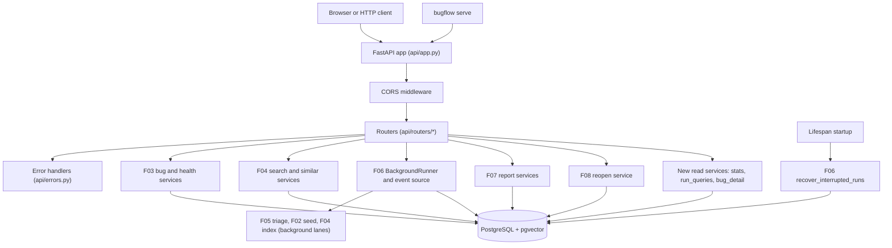

# Spec: F09. API, Operations and Parity

**Complexity:** medium (one new FastAPI package with about 20 endpoints and SSE, four small read-only service modules, one new CLI command, no new tables, no migrations, two new runtime dependencies and one new test dependency).

## 1. Technical Overview

**What.** Add the HTTP surface of BugFlow: a FastAPI application served under `/api/v1` with OpenAPI at `/docs`, started by the new command `bugflow serve`. The API is a thin layer over the services that F02 to F08 already provide. It exposes health, canonical enums, dashboard stats, the administrative operations (init, seed, reset, index), bug management (create, list, detail, edit, similar, runs, reopen, report), semantic search, triage runs and run progress (polling and Server-Sent Events). Long operations (`seed`, `index`, `triage`) are scheduled on the F06 `BackgroundRunner` and answered with `202` and run ids at once; progress is read from the persisted run rows through the F06 event source. All errors use one JSON error model with fixed, secret-free English messages. CORS allows only the configured frontend origin. An automated parity test fails when a CLI command has no registered API route.

**Why.** The frontend (F10 to F14) must never touch the database, the LLM or secrets (PRD user stories). Every capability the demo needs from a browser already exists as a service function for the CLI, so F09 only adds routing, request and response models, error mapping and the small read models the services lack (stats, run listing, bug detail with results). Keeping the API thin preserves the architecture rule from F03: business logic lives only in `bugflow.services`.

**Scope.**

Included:
- Application factory `create_app(...)`, lifespan (startup recovery, report hook, runner), router modules for the 20 endpoints of the PRD table, error handlers, CORS, SSE formatting.
- Read-only service modules: `stats`, `run_queries`, `bug_detail` (see section 4).
- `bugflow serve` command (host and port from settings, overridable by options).
- The CLI to API parity map and its automated parity test.
- API smoke test (health, create bug, list bugs) that runs without a real LLM.
- Test-only injection points on `create_app` (LLM probe, client factory, agent runner, fault hook) so tests need no network.

Excluded (PRD Section 7 and the F09 definition):
- Authentication, authorization, multi-user behavior. The server is local and single-user.
- Rate limiting, pagination of runs beyond a `limit`, deleting bugs, bulk import and export.
- Running the API inside Docker Compose, TLS, a process manager.
- Any frontend code (F10 to F14) and the README quickstart (F15).

## 2. Architecture Impact

Affected components (all paths under `backend/`):

- `src/bugflow/api/` (new package): app factory, dependencies, error mapping, routers, SSE helper, parity map.
- `src/bugflow/services/{stats,run_queries,bug_detail}.py` (new): read-only queries returning Pydantic models.
- `src/bugflow/cli/commands/serve.py` (new) and `src/bugflow/cli/__init__.py` (modified): register `serve`.
- `pyproject.toml` and `uv.lock` (modified): new dependencies (see section 3, decision 1).
- `tests/` (new files, section 7).



Request flow: an endpoint function (a plain `def`, run in FastAPI's thread pool because all services are blocking) validates input, opens a session from the application engine, calls one service, commits when the service only flushes, and returns a Pydantic response model. Domain errors propagate to the handlers in `api/errors.py`, which map them to the error model.

## 3. Technical Decisions

| Decision | Chosen Approach | Alternative Considered | Trade-off |
|---|---|---|---|
| 1. New dependencies | Add `fastapi` and `uvicorn` to `[project].dependencies` and `httpx` to the `dev` group (for `fastapi.testclient.TestClient`). Versions are chosen with `uv add` against the lockfile. `starlette`, `uvicorn` and `httpx` are already present transitively through CrewAI, but a direct dependency is declared for each import the code makes. | Rely on the transitive packages | An explicit pin documents intent and survives a CrewAI change; the cost is lockfile churn. AGENTS.md requires asking before adding a dependency the plan does not list, so the plan lists exactly these three. |
| 2. SSE implementation | `StreamingResponse` over a sync generator that wraps `iter_run_events`, formatted by a small helper in `api/sse.py` | `sse-starlette` (already installed transitively) | One fewer direct dependency and full control of the frame format; the cost is hand-written framing (about 20 lines). |
| 3. Sync endpoints | Plain `def` endpoints; FastAPI runs them in its thread pool | `async def` with `run_in_threadpool` | All services are blocking SQLAlchemy and psycopg calls; plain `def` is the simplest correct form. The SSE generator also blocks (poll sleep) and is iterated in the pool by Starlette. |
| 4. App construction | `create_app(settings, engine, *, runner=None, llm_probe=None, get_client=None, fault=None)` returns the app; state lives on `app.state` | Module-level app object | A factory lets tests inject an engine, a fake probe and the stand-in client, and lets `serve` build everything from settings. |
| 5. Error model | One `ApiError` envelope `{"error": {"code", "message", "details"}}` produced by exception handlers for service errors, request validation errors, HTTP exceptions and unhandled exceptions | FastAPI default `{"detail": ...}` | The frontend gets one shape; handlers also guarantee no stack trace and no secret leaves the process. |
| 6. Confirmation guard | Request model `ConfirmBody` with a `confirm` field that must be `true`; validated before any service call | Query flag or header | Matches the PRD body contract; an invalid body is a `422` with a per-field detail and nothing is touched. |
| 7. Parity enforcement | A constant `PARITY` map (CLI command path to HTTP method and path) in `api/parity.py` plus a pure function `find_parity_gaps(cli_app, routes)` used by the test | Parse the README table | A code-level map is the single machine-checked source; F15 verifies the README against the same map. |
| 8. Operation styles | `seed`, `index`, `triage` are asynchronous (`202`, run ids); `init`, `reset`, `check` are synchronous (`200`) | Make every operation asynchronous | The PRD marks only seed, index and triage as `202`. Init and reset recreate the schema the run tables live in, so a run row for them is written by the existing `run_init` and `run_reset` services after the work and cannot be polled from a `202`. |

### Assumptions and Decisions (review and override as needed)

1. **Scope.** The F09 block has no Core and Full split; the whole feature is in scope (Auto-Accept scope row).
2. **Quality gates** (auto-included, detected from AGENTS.md section 4 and `backend/pyproject.toml`), all run from `backend/`: `uv run ruff format .`, `uv run ruff check .`, `uv run pytest`. No wrapper script in `scripts/` consolidates them. Integration tests run only on request with `uv run pytest -m integration`.
3. **New dependencies (requires user confirmation before implementation).** `backend/pyproject.toml` lists neither `fastapi` nor `uvicorn` and the lockfile has no `fastapi`. The plan adds `fastapi` and `uvicorn` as runtime dependencies and `httpx` as a dev dependency (decision 1). This is the only dependency change; AGENTS.md section 5 requires the user to approve it.
4. **Contract surfaces.** PRD signals exist for an HTTP API (endpoints), a CLI (`serve`), background work (202 operations, startup recovery), an event stream (SSE), a parity check and cross-surface flows. Emitted: `HTTP API`, `CLI`, `Worker`, `Parity` (documented extension) and `E2E`. Not emitted: `Service` (the new read services have no consumer outside F09; F10 consumes HTTP only), `UI` (F10 to F14), `Event` (SSE is an HTTP response; the bus-style Event surface does not apply).
5. **Endpoint paths and prefix.** All 20 endpoints live under `/api/v1`. The OpenAPI JSON is at `/openapi.json` and the interactive docs at `/docs`, both outside the prefix (FastAPI defaults), so `NEXT_PUBLIC_API_BASE_URL` (which ends in `/api/v1`) keeps working.
6. **Health.** `GET /health` always returns `200` with the three checks side by side and an overall `ok` flag, because the check is the diagnostic itself and the Health panel needs the per-check detail. A failed check is data, not an HTTP failure. `503` is reserved for endpoints that need an unavailable database or LLM.
7. **Stats shape.** `GET /stats` returns `total`, `by_status`, `by_component` and `by_severity`. Every code of the corresponding enum is present with a count (zero when none). Component and severity counts come from the stored classification rows of bugs that have them (a reopened or open bug has none).
8. **Bug detail.** `GET /bugs/{id}` returns the F03 `BugRead` fields plus `results` (component, severity, analysis, plan, report summary with `has_markdown`/`has_html`), each `null` when the bug has no stored result, and `latest_run` (the most recent run of the bug, or `null`) so the UI can show the Errors tab. Report bodies are not embedded; they come from `/bugs/{id}/report`.
9. **Report endpoint.** `format` is `json` (default), `md` or `html`. `json` returns `{bug_id, markdown, html}`. `md` returns `text/markdown; charset=utf-8` and `html` returns `text/html; charset=utf-8`, the stored text byte for byte, as `bugflow report` prints it. The F07 `get_report` renders and stores a missing format, so the endpoint commits when `rendered` is true. A bug without a report is `404` with the F07 message.
10. **Run listing.** `GET /runs` accepts `type`, `status` (enum codes) and `limit` (default 10, range 1 to 100), newest first by start time then id. `GET /bugs/{id}/runs` returns all runs of the bug, newest first, and `404` for an unknown bug.
11. **Run detail.** `GET /runs/{id}` returns `{run, steps, logs}` with steps ordered by position and logs by id, the same shapes the SSE events carry, so a poller and a stream client see identical data.
12. **SSE framing.** Each event is `id: <cursor>`, `event: step|log|run`, `data: <JSON of the F06 event model>` followed by a blank line. The stream starts from the `after` query parameter or the `Last-Event-ID` header (a cursor from a previous event), emits events as the F06 event source produces them (500 ms poll), and ends after the terminal `run` event. An unknown run is a normal `404` JSON error before any stream byte; an invalid cursor is `422` with field `after`. Response headers: `Content-Type: text/event-stream; charset=utf-8`, `Cache-Control: no-cache`, `X-Accel-Buffering: no`.
13. **Start semantics.** `POST /triage-runs` accepts exactly one of `{"bug_id": <int>}` or `{"all": true}` and returns `202 {"run_ids": [...]}` (one id for a bug, one per open bug for `all`, possibly an empty list). `POST /admin/db/seed` and `POST /admin/index` take no body and return `202 {"run_ids": [<id>]}`. The F06 runner performs claiming and validation; its `StateConflictError` is `409`, `NotFoundError` is `404`, validation errors are `422`.
14. **Synchronous admin.** `POST /admin/db/init` returns `200 {"applied_revisions": [...], "messages": [...]}` using `run_init` and `init_messages`. `POST /admin/db/reset` requires `{"confirm": true}` and returns `200` with the same shape using `reset_db` directly, so the API reset records no run row (the CLI `db reset` still records one through `run_reset`). `init` uses `run_init` and records a run, as in the CLI. Both manage their own transactions.
15. **Index and a missing key.** `POST /admin/index` does not check the key at request time; the F06 runner builds the client inside the run, so a missing or rejected key produces a `failed` run with a fixed message (for example "OpenAI authentication failed") that is readable through `/runs/{id}`. Endpoints that call the LLM inline (`/search`, `/bugs/{id}/similar`) answer `503` with the fixed message when the key is missing or the provider is unavailable.
16. **Status mapping.** `ValidationFailedError` and request validation errors: `422` (code `validation_error`, `details` is a list of `{field, message}`); `EmptySearchTextError`: `422` (field `q`); `NotFoundError`: `404` (`not_found`); `StateConflictError` and `SchemaNotInitializedError`: `409` (`state_conflict`); `DatabaseUnavailableError`, `PgvectorUnavailableError`, `LlmError` and `ConfigError`: `503` (`service_unavailable`); malformed JSON: `400` (`bad_request`); unknown route: `404` (`not_found`); wrong method: `405` (`method_not_allowed`); `ReopenFailedError`, `ReportRenderError`, other `ServiceError` and every unhandled exception: `500` (`internal_error`). The `500` message for an unhandled exception is the fixed text "Internal server error"; the original text goes only to the redacted log.
17. **Secrets.** No endpoint returns settings. Error text for service errors is already fixed English; the handlers pass any other text through the F01 `Redactor`. The OpenAPI document contains no configured value. The log line for an unhandled exception is redacted by the F01 filter.
18. **CORS.** `CORSMiddleware` with `allow_origins=settings.cors_origins`, methods `GET, POST, PATCH, OPTIONS`, headers `Content-Type, Last-Event-ID`, no credentials. A request from another origin gets no `Access-Control-Allow-Origin` header.
19. **Startup.** The lifespan installs the F07 report hook (as the CLI bootstrap does), builds the `BackgroundRunner` with a lazy client factory (`OpenAILlmClient.from_settings`), then calls `recover_interrupted_runs`. If the database is unreachable at startup the server still starts, logs a warning and serves `503` or failed health checks until the database is back; recovery is not retried automatically. On shutdown the runner is shut down.
20. **`bugflow serve`.** Options `--host` and `--port` default to `API_HOST` and `API_PORT` (`127.0.0.1`, `8000`). It builds settings through `bugflow.config`, runs `uvicorn` with the app from `create_app`, and prints `Serving BugFlow API on http://<host>:<port> (docs at /docs)`. A host other than a loopback address additionally prints a one-line warning that the API has no authentication. A missing `DATABASE_URL` fails fast with the F01 message and exit code 1 (the shared `guarded` decorator). A missing `OPENAI_API_KEY` does not prevent startup.
21. **Parity map.** The nine parity commands are `check`, `db init`, `db seed`, `db reset`, `index`, `search`, `triage`, `reopen`, `report`. `serve` is excluded. The test walks the Typer command tree, so a new command that is neither mapped nor excluded fails the test.
22. **Conventions reused (Layer 1 and Layer 2 discovery).** Python 3.12, uv, Ruff (`line-length = 100`, rules E F I UP B), pytest with the `integration` marker and `TEST_DATABASE_URL`, Typer CLI registry with `register(app)` modules and `guarded`/`echo` helpers, services taking an engine or session and returning frozen Pydantic models, fixed English error messages, one `bootstrap()` that builds settings, logging and the engine, stand-in OpenAI server under `tests/mocks/`, per-test schema reset fixtures (`initialized_db`, `seeded_db`), child-process CLI tests with a scrubbed environment and `OPENAI_BASE_URL` pointing at the stand-in, `TZ=UTC`. Fixtures: no static input files (`tests/fixtures/` holds only `.gitkeep`); persistent state is created through the F02 ORM models with `tests_helpers.py` helpers. Test configuration comes from the process environment (no `.env.test`, no root `.env`).
23. **Fixture names.** F09 uses its own handles (`open-bug`, `second-open-bug`, `processed-bug`, `processing-bug`, `seed-run`, `interrupted-state`) and never redefines the fixtures of earlier features.
24. **Test-only injection.** `create_app` accepts `llm_probe`, `get_client`, `runner` and `fault`. `fault` is a callable invoked at the start of the bug listing service call so a test can raise an unexpected error; production never passes it. This is the Preparation Pattern for the "unexpected error" behavior and keeps the contract exercisable with F09 and its dependency closure alone.
25. **Concurrency of reset.** `reset` while a background run is active is not guarded in F09 (the PRD does not specify it); the single-user local setting makes it a documented limitation.

### PRD Traceability

| PRD block | Where it lands in this spec |
|---|---|
| Consumes: F03, F04, F06, F07, F08 services | section 2 diagram; section 5 endpoint table; section 4 router rows |
| Provides: REST API, OpenAPI at `/docs` | assumptions 5, 13 to 16; section 5 |
| Provides: SSE and polling progress endpoints | assumptions 11, 12; section 5.4 |
| Provides: enums endpoint, stats endpoint | assumptions 7; section 5.2 |
| Provides: `bugflow serve` | assumption 20; section 5.5 |
| Capabilities: server, CORS, no auth, recovery | assumptions 18, 19 |
| Capabilities: endpoints table | section 5 |
| Capabilities: error model | assumption 16; section 5.1 |
| Capabilities: progress, secrets | assumptions 12, 17 |
| Capabilities: CLI to UI parity contract and parity test | assumptions 21; section 4 (`api/parity.py`); section 7 |
| Capabilities: API smoke test | section 7 (`test_api_smoke.py`) |
| Experience: `serve`, `/docs`, 202 and run id | assumptions 13, 20 |

## 4. Component Overview

**Backend (new):**

| File Path | New/Modified | Purpose | Key Responsibilities |
|---|---|---|---|
| `src/bugflow/api/__init__.py` | New | Package marker | Exports `create_app` |
| `src/bugflow/api/app.py` | New | Application factory and lifespan | Build app, include routers under `/api/v1`, add CORS, install handlers, startup recovery, report hook, runner lifecycle |
| `src/bugflow/api/deps.py` | New | Request dependencies | Provide the engine, a session per request, the runner, settings, the LLM client getter and the probe |
| `src/bugflow/api/errors.py` | New | Error model and handlers | `ApiError` envelope, status mapping of assumption 16, redaction, no stack traces |
| `src/bugflow/api/schemas.py` | New | Request and response models | `ConfirmBody`, `TriageRunBody`, `RunIdsResponse`, `HealthResponse`, `EnumsResponse`, `StatsResponse`, `BugDetail`, `ReportJson`, `RunDetail`, `InitResponse` |
| `src/bugflow/api/sse.py` | New | SSE helper | Format events, resolve the start cursor, wrap `iter_run_events` as a byte generator |
| `src/bugflow/api/parity.py` | New | Parity map and checker | `PARITY`, `EXCLUDED`, `find_parity_gaps` |
| `src/bugflow/api/routers/system.py` | New | Health, enums, stats | `GET /health`, `GET /meta/enums`, `GET /stats` |
| `src/bugflow/api/routers/admin.py` | New | Administrative operations | `POST /admin/db/init`, `/admin/db/seed`, `/admin/db/reset`, `/admin/index` |
| `src/bugflow/api/routers/bugs.py` | New | Bug endpoints | list, create, detail, edit, similar, runs, reopen, report |
| `src/bugflow/api/routers/search.py` | New | Semantic search | `GET /search` |
| `src/bugflow/api/routers/runs.py` | New | Runs and progress | `POST /triage-runs`, `GET /runs`, `GET /runs/{id}`, `GET /runs/{id}/events` |
| `src/bugflow/services/stats.py` | New | Dashboard counts | `dashboard_stats(session)` returning zero-filled counts |
| `src/bugflow/services/run_queries.py` | New | Run read models | `list_runs`, `list_bug_runs`, `get_run_detail` |
| `src/bugflow/services/bug_detail.py` | New | Bug detail with results | `get_bug_detail(session, bug_id)` |
| `src/bugflow/cli/commands/serve.py` | New | `bugflow serve` | Options, banner, uvicorn start, loopback warning |
| `src/bugflow/cli/__init__.py` | Modified | Command registry | Add `serve` to `COMMAND_MODULES` |
| `pyproject.toml`, `uv.lock` | Modified | Dependencies | Add `fastapi`, `uvicorn`, dev `httpx` |

**Database:** none. No migration, no new table.

## 5. API Contracts

All paths are relative to `/api/v1`. Success bodies are JSON unless stated. No authentication.

### 5.1 Error model

```json
{
  "error": {
    "code": "validation_error",
    "message": "Validation failed",
    "details": [
      {"field": "title", "message": "must be at most 120 characters"},
      {"field": "environment", "message": "must be one of: production, staging, development, testing"}
    ]
  }
}
```

| Code | HTTP Status | Description |
|---|---|---|
| `bad_request` | 400 | Malformed JSON body |
| `not_found` | 404 | Unknown bug, run or route |
| `method_not_allowed` | 405 | Known path, wrong method |
| `state_conflict` | 409 | Not allowed in the current state (processing bug, edit of a non-open bug, schema not initialized) |
| `validation_error` | 422 | Per-field `details` list (`field` is `body` for a missing or non-object body) |
| `internal_error` | 500 | Unexpected failure; fixed message, no stack trace |
| `service_unavailable` | 503 | Database, pgvector or LLM unavailable; fixed message |

### 5.2 System endpoints

| Method | Path | Success | Notes |
|---|---|---|---|
| GET | `/health` | 200 | Body below |
| GET | `/meta/enums` | 200 | One entry per canonical enum, from `bugflow.enums.all_enums()` |
| GET | `/stats` | 200 | Zero-filled counts |

`GET /health`:

```json
{
  "ok": false,
  "database": {"ok": true, "message": "ok"},
  "vector_search": {"ok": true, "message": "ok"},
  "llm": {"ok": false, "message": "OPENAI_API_KEY is not set"}
}
```

`GET /meta/enums`:

```json
{
  "enums": [
    {"name": "BugStatus", "values": [
      {"code": "open", "label": "Open", "definition": null}
    ]},
    {"name": "Severity", "values": [
      {"code": "critical", "label": "Critical", "definition": "data loss, security breach, or complete failure of a core function with no workaround"}
    ]}
  ]
}
```

`GET /stats`:

```json
{
  "total": 20,
  "by_status": {"open": 18, "processing": 0, "processed": 2, "failed": 0},
  "by_component": {"frontend": 1, "backend": 1, "database": 0, "devops": 0, "security": 0, "integration": 0, "ui_ux": 0, "infrastructure": 0},
  "by_severity": {"critical": 0, "major": 2, "minor": 0}
}
```

### 5.3 Administrative endpoints

| Method | Path | Request | Success | Errors |
|---|---|---|---|---|
| POST | `/admin/db/init` | none | 200 `{"applied_revisions": ["0001"], "messages": ["Applied migration 0001"]}` | 503 |
| POST | `/admin/db/seed` | none | 202 `{"run_ids": [12]}` | 409 (schema not initialized), 503 |
| POST | `/admin/db/reset` | `{"confirm": true}` | 200 same shape as init | 422 (missing body or `confirm` not true), 503 |
| POST | `/admin/index` | none | 202 `{"run_ids": [13]}` | 409, 503 |

### 5.4 Bugs, search and runs

| Method | Path | Request | Success | Errors |
|---|---|---|---|---|
| GET | `/bugs` | query: `status`, `component`, `severity`, `environment`, `reporting_team`, `search`, `sort_by`, `sort_dir`, `page`, `page_size` (F03 `BugListQuery`) | 200 `{items, total, page, page_size}` | 422 |
| POST | `/bugs` | body: F03 `BugCreate` | 201 `BugRead` | 400, 422 |
| GET | `/bugs/{id}` | none | 200 `BugDetail` | 404 |
| PATCH | `/bugs/{id}` | body: F03 `BugUpdate` | 200 `BugRead` | 404, 409, 422 |
| GET | `/bugs/{id}/similar` | query: `limit` (1 to 20, default `SIMILAR_BUGS_K`) | 200 `{items: [{bug_id, title, status, score}]}` | 404, 422, 503 |
| GET | `/bugs/{id}/runs` | none | 200 `{items: [RunRead]}` newest first | 404 |
| POST | `/bugs/{id}/reopen` | `{"confirm": true}` | 200 `BugRead` | 404, 409, 422, 500 |
| GET | `/bugs/{id}/report` | query: `format` = `json` (default), `md`, `html` | 200 (see assumption 9) | 404, 422 |
| GET | `/search` | query: `q` (required), `limit` (1 to 20, default 5) | 200 `{items: [{bug_id, title, status, score}], hint}` | 422, 503 |
| POST | `/triage-runs` | `{"bug_id": 1}` or `{"all": true}` | 202 `{"run_ids": [14]}` | 404, 409, 422 |
| GET | `/runs` | query: `type`, `status`, `limit` | 200 `{items: [RunRead]}` newest first | 422 |
| GET | `/runs/{id}` | none | 200 `{run, steps, logs}` | 404 |
| GET | `/runs/{id}/events` | query `after` or header `Last-Event-ID` | 200 `text/event-stream` | 404, 422 |

`POST /triage-runs` request and response:

```json
{"bug_id": 1}
```

```json
{"run_ids": [14]}
```

`GET /bugs/{id}` (processed bug, abbreviated):

```json
{
  "id": 1,
  "title": "Checkout button does nothing on Safari 17",
  "status": "processed",
  "environment": "production",
  "reporting_team": "support",
  "opened_at": "2026-10-01T10:00:00Z",
  "updated_at": "2026-10-06T12:00:00Z",
  "component": "frontend",
  "severity": "major",
  "results": {
    "component": {"component": "frontend", "justification": "..."},
    "severity": {"severity": "major", "justification": "...", "user_impact": "..."},
    "analysis": {"root_cause": "...", "technical_impact": "...", "debugging_approach": ["..."], "proposed_solution": "...", "side_effects": ["..."], "referenced_similar_bug_ids": []},
    "plan": {"resolution_status": "planned", "assigned_team": "frontend", "assignee_profile": {"role": "...", "seniority": "senior", "skills": ["..."]}, "target_days": 5, "priority": "high", "notes": ""},
    "report": {"executive_summary": "...", "key_takeaways": ["..."], "next_steps": ["..."], "has_markdown": true, "has_html": true}
  },
  "latest_run": {"id": 5, "type": "triage", "status": "succeeded", "progress_done": 5, "progress_total": 5, "error": null, "started_at": "...", "finished_at": "..."}
}
```

SSE frames for `GET /runs/{id}/events`:

```
id: 3.ss---.q
event: step
data: {"type":"step","cursor":"3.ss---.q","step":{"position":1,"agent_key":"component_classifier","status":"succeeded"}}

event: run
data: {"type":"run","cursor":"7.sssss.s","run":{"id":5,"status":"succeeded"}}
```

### 5.5 CLI

`bugflow serve [--host TEXT] [--port INTEGER]`: starts the API; prints the banner of assumption 20; exit code 0 after a clean shutdown, 1 on configuration errors. Appears in `bugflow --help` as "Start the BugFlow API server."

## 6. Data Model

No new tables, columns, indexes or migrations. F09 reads the F02 tables (`bugs`, the five result tables, `runs`, `run_steps`, `run_logs`, `bug_embeddings`) only through services. The new read services use parameterized SQLAlchemy queries; the stats counts use `GROUP BY` on the status, component and severity columns. No dynamic identifiers are used.

## 7. Testing Strategy

Unit tests run offline with `fastapi.testclient.TestClient` against `create_app` with a fake engine-free configuration where possible; integration tests (marker `integration`, `TEST_DATABASE_URL`) exercise the real database and the OpenAI stand-in.

| Test File | Test Type | Target | Coverage Goal |
|---|---|---|---|
| `tests/unit/test_api_errors.py` | Unit | `api/errors.py` status mapping and redaction | every mapped exception type |
| `tests/unit/test_api_sse.py` | Unit | `api/sse.py` framing and cursor selection | all frame fields |
| `tests/unit/test_api_cors.py` | Unit | CORS behavior | allowed and disallowed origin, preflight |
| `tests/unit/test_api_openapi.py` | Unit | OpenAPI document and route table | the 20 method and path pairs |
| `tests/unit/test_api_parity.py` | Unit | `api/parity.py` | real app passes, synthetic gap fails |
| `tests/unit/test_cli_serve.py` | Unit | `serve` command | defaults, options, loopback warning, config errors |
| `tests/unit/test_api_bodies.py` | Unit | request models | confirm guard, triage body, malformed JSON |
| `tests/unit/test_stats_service.py` | Unit | `services/stats.py` zero filling logic | pure assembly of counts |
| `tests/integration/test_api_smoke.py` | Integration | health, create bug, list bugs without a real LLM | the smoke path |
| `tests/integration/test_api_system.py` | Integration | health, enums, stats | all three |
| `tests/integration/test_api_bugs.py` | Integration | bug endpoints | create, list, detail, edit, similar, runs, reopen, report |
| `tests/integration/test_api_search.py` | Integration | search endpoint | limits, empty text, no embedding call on invalid input |
| `tests/integration/test_api_admin.py` | Integration | init, seed, reset, index | confirm guard, 202 timing, run outcomes |
| `tests/integration/test_api_triage_runs.py` | Integration | `/triage-runs`, `/runs` | 202, 409, 422, listing, detail |
| `tests/integration/test_api_events.py` | Integration | SSE | finished run, resume, live run |
| `tests/integration/test_api_secrets.py` | Integration | leak checks | key and password never in responses |
| `tests/integration/test_api_recovery.py` | Integration | startup recovery | interrupted run and bug |
| `tests/integration/test_serve_process.py` | Integration | `bugflow serve` child process | bind address, port, missing key, database down |
| `tests/integration/test_api_parity_effects.py` | Integration | API effect equals CLI effect per parity row | seed, index, triage, reopen, report, search, check, init, reset |

Key test functions:

| Test Function | Description | Assertions |
|---|---|---|
| `test_confirm_required_for_reset` | Body missing or `confirm` false | 422 with field detail, row counts unchanged |
| `test_confirm_required_for_reopen` | Same for reopen | 422, bug status and result rows unchanged |
| `test_triage_run_returns_202_fast` | Start triage with the stand-in | 202 within 1 s, one run id |
| `test_triage_all_returns_run_per_open_bug` | Two open bugs | two run ids |
| `test_triage_processing_bug_conflict` | Bug is `processing` | 409 `state_conflict`, no new run |
| `test_triage_body_validation` | Missing body, `{}`, wrong types, extra keys | 422 with per-field details |
| `test_events_stream_closes_on_terminal` | Finished run | frames of step, log and run types, stream ends |
| `test_events_match_polling` | Same finished run | steps and logs equal `GET /runs/{id}` |
| `test_events_resume_from_cursor` | `Last-Event-ID` set | only later events |
| `test_enums_endpoint_matches_module` | Compare with `all_enums()` | every enum, codes and labels equal |
| `test_no_secret_in_any_response` | Canary key and password configured | neither string appears in bodies or headers |
| `test_cors_blocks_other_origin` | Origin `http://evil.example` | no `Access-Control-Allow-Origin` header |
| `test_parity_gap_detected` | Add a synthetic CLI command | `find_parity_gaps` names it |
| `test_parity_real_app_has_no_gaps` | Real CLI and app | empty gap list |
| `test_serve_defaults_bind_loopback` | No options, default settings | host `127.0.0.1`, port `8000` passed to uvicorn |
| `test_startup_recovery_marks_interrupted` | Seeded interrupted run, app startup | run `failed` with `interrupted`, bug `failed` |
| `test_unexpected_error_is_generic` | Fault hook raises with the canary in its text | 500, fixed message, canary absent, no traceback |
