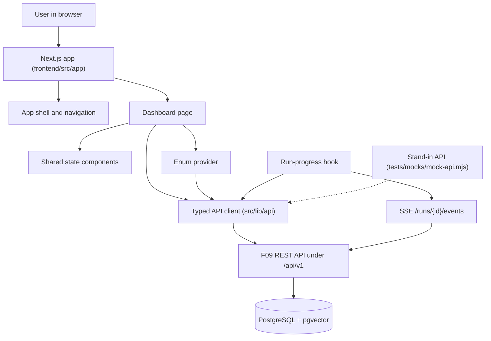

# Spec: F10. Frontend Shell and Dashboard

**Complexity:** medium (a new `frontend/` project with about 35 source files, no new backend endpoint, no database change, one hand-written typed client for 20 existing endpoints, one hook with two transports, one dependency-free stand-in API server, and a large set of new npm dependencies because the repository has no frontend yet).

## 1. Technical Overview

**What.** Create the BugFlow web frontend foundation in `frontend/`: a Next.js application (App Router, TypeScript, ESLint) that runs on the host at port 3000 and talks to the F09 REST API at `NEXT_PUBLIC_API_BASE_URL`. The feature delivers (a) the application shell with a header and the four-item navigation Dashboard, Bugs, Search and Operations, (b) a typed API client covering every F09 endpoint, (c) a run-progress hook that follows a run over Server-Sent Events and falls back to polling, (d) an enum provider that loads the canonical codes, labels and definitions once from `/meta/enums`, (e) shared loading, empty and error state components, and (f) the Dashboard page with counts by status, component and severity plus the 10 most recent runs. The three destination routes `/bugs`, `/search` and `/operations` exist as placeholder pages inside the shell so that navigation never ends in a 404 until F11, F14 and F13 replace them.

**Why.** F11 to F14 need one shared, tested base so that they only write pages. Keeping all HTTP knowledge in one client, all vocabulary in one provider and all loading, empty and error presentation in three components prevents drift between pages and keeps the browser free of secrets and LLM calls (the backend owns both). Because the frontend is a new project, the feature also fixes the toolchain (package manager, test runner, lint, typecheck, build, styling) that every later frontend feature inherits.

**Scope.**

Included:
- `frontend/` scaffold: Next.js (App Router, TypeScript, ESLint), pinned version, `npm run dev` on port 3000 (overridable with `PORT`), scripts `lint`, `typecheck`, `test`, `check:enums`, `build`, `mock:api`, `test:e2e`.
- Shell: root layout, header with product name, primary navigation (inline on wide screens, behind a "Menu" button on narrow screens), not-found page inside the shell, placeholder routes `/bugs`, `/search`, `/operations`.
- API client for all 20 F09 endpoints (see section 5), typed errors, base URL from `NEXT_PUBLIC_API_BASE_URL`.
- Run-progress hook (SSE with polling fallback, 1 s interval).
- Enum provider and lookup helpers.
- Shared `LoadingState`, `EmptyState` and `ErrorState` components.
- Dashboard at `/`: counts by status, component and severity from `/stats`; the 10 most recent runs from `/runs?limit=10` with type, status, duration and link; refetch on every visit; empty, loading and error states.
- Responsive layout down to 375 px wide.
- Test tooling: unit and component tests, a dependency-free stand-in API server under `frontend/tests/mocks/`, JSON fixtures under `frontend/tests/fixtures/`, browser tests (E2E) behind an explicit script, and the enum-duplication check script.
- Root `.gitignore` additions for frontend build output (see section 4).

Excluded (PRD Section 7 and the F10 definition):
- The bug list, bug form and bug detail (F11), the agent trace view and the `/runs/[id]` route that the Dashboard links to (F12), the Operations console (F13), the Search page behavior (F14), the README quickstart (F15).
- Authentication, theming, internationalization, accessibility audit, CI/CD, running the frontend in Docker Compose, server-side rendering of API data, any LLM call or secret in the browser.
- Any change to the backend. The F09 API is consumed as it is.

## 2. Architecture Impact

Affected components (all new unless stated):

- `frontend/` (new project): configuration files, `src/app` routes, `src/components`, `src/lib`, `src/hooks`, `src/providers`, `tests/`.
- `.gitignore` (modified): ignore `next-env.d.ts`, `*.tsbuildinfo`, `playwright-report/`, `test-results/`.
- No change under `backend/`, `scripts/`, `docker-compose.yml` or `.env.example` (`NEXT_PUBLIC_API_BASE_URL` already exists there).

Request flow: every page is rendered in the browser. A client component calls the client through the data hook, shows `LoadingState` while pending, `ErrorState` (with Retry) on failure and `EmptyState` when the data says there is nothing to show. The browser calls the API directly (the API allows the origin `http://localhost:3000` through CORS); the Next.js server never fetches API data, so there is no server-side secret and no server-to-API hop.

## 3. Technical Decisions

| Decision | Chosen Approach | Alternative Considered | Trade-off |
|---|---|---|---|
| 1. Framework and version | Next.js, App Router, TypeScript, ESLint, pinned to an exact version. Current stable at spec time: `16.4.0` (React 19.3, requires Node 20.9 or newer). The implementer re-checks `npm view next dist-tags.latest` and pins that exact version | Pages Router; caret ranges | App Router is the PRD choice; exact pin gives reproducible builds; the cost is a manual bump |
| 2. Package manager and Node | `npm` with committed `package-lock.json`; Node 24 LTS recorded in `frontend/.nvmrc` and `engines` set to `>=22.12.0` (the strictest dependency requirement, Vitest 5) | pnpm or yarn | `npm` ships with Node and matches the PRD commands (`npm install`, `npm run dev`); no extra tool to install |
| 3. Rendering model | Client-side data fetching in client components; the layout and static pages stay server components | Server components that fetch from the API | The Dashboard must refresh on each visit and the API runs on another origin; browser fetch keeps one code path and one error model |
| 4. Data fetching | Native `fetch` behind a typed client, plus one small generic hook (`useApiResource`) returning `loading`, `success` or `error` and a `reload` function | SWR or TanStack Query | Zero dependencies and exactly the needed behavior (refetch on mount, manual retry); the cost is no cache sharing, which this feature does not need |
| 5. API types | Hand-written TypeScript types in `src/lib/api/types.ts` mirroring the F09 response models | Generating types from `/openapi.json` with a generator package | No generator dependency and no need for a running backend at build time; the cost is manual sync, mitigated by the fixtures and the E2E comparison against the real API |
| 6. Styling | Plain CSS: one global stylesheet with CSS custom properties, plus CSS Modules per component; responsive through media queries at 640 px | Tailwind CSS; a component library | No dependency or build plugin; theming is out of scope so tokens stay minimal |
| 7. Unit and component tests | Vitest with jsdom, React Testing Library, `@testing-library/jest-dom` and `@testing-library/user-event`; `fetch` and `EventSource` replaced by hand-written fakes in `tests/setup` | Jest; MSW | Vitest runs TypeScript and ESM without extra config; hand-written fakes avoid the MSW dependency |
| 8. Browser tests | Playwright test runner, Chromium only, run only through `npm run test:e2e` (never part of the default gate), configured to start the stand-in API and the dev server | Cypress; no browser tests | A real browser is required to verify the 375 px layout, navigation and the real EventSource; Playwright is the common default; the opt-in script mirrors the backend's `-m integration` rule |
| 9. Stand-in API | A Node standard-library HTTP server (`tests/mocks/mock-api.mjs`) that serves the F09 shapes from JSON fixtures, supports named scenarios, plays a scripted live run over SSE and records received requests; control endpoints under `/_control/` follow the backend stand-in convention | MSW in the browser; hand-run real backend only | Makes Service, CLI and UI behaviors verifiable with F10 alone (Preparation Pattern) and deterministic; the cost is one more file to keep aligned with F09 shapes |
| 10. Base URL | A single module `src/lib/config.ts` is the only code that reads `process.env`; it exposes `apiBaseUrl` from `NEXT_PUBLIC_API_BASE_URL`, default `http://localhost:8000/api/v1`, trailing slashes removed | Reading the variable at each call site | One place to audit for secrets; mirrors the backend `bugflow.config` rule |
| 11. Run progress transport | Browser `EventSource` on `/runs/{id}/events`; on the first stream error before a terminal event the hook closes the stream and polls `GET /runs/{id}` every 1,000 ms until a terminal status; state is merged by step position and log id so no entry appears twice | Polling only; automatic `EventSource` reconnect | The PRD asks for SSE with a polling fallback; closing on first error gives one predictable fallback instead of two competing reconnect mechanisms |
| 12. Enum access | `EnumProvider` (React context) fetches `/meta/enums` once; helpers `label(enumName, code)` and `values(enumName)`; an unknown code or enum returns the code itself; a failed load is an error state with Retry and never a built-in fallback | Static enum module in the source | The PRD forbids hard-coded duplicates; enum names (such as `BugStatus`) are identifiers, not labels, and may appear in the source |
| 13. Enum duplication guard | A script `scripts/check-enums.mjs` reads `tests/fixtures/enums.json` and fails if any code or label string appears as a literal under `src/` | Reviewer discipline only | Turns the PRD rule into a gate; short codes that collide with common words are matched only as whole quoted literals |
| 14. Dashboard failure model | One request group (`/stats`, `/runs?limit=10` and the enums) per visit; any failure shows a single error banner with Retry and no partial counts | Independent panel errors | Simpler to reason about and matches "with the API down it shows an error with Retry"; the cost is that a failing runs request hides valid counts |

### Assumptions and Decisions (review and override as needed)

1. **Scope.** The F10 block has no Core and Full split; the whole feature is in scope (Auto-Accept scope row).
2. **Empty-codebase bootstrap (Auto-Accept row).** `frontend/` does not exist, so no frontend pattern could be observed. Every frontend choice in section 3 is an industry-standard default and is listed here for review: Next.js App Router with TypeScript and ESLint flat config; `src/` directory layout; npm; Node 24 LTS; native fetch; CSS Modules; Vitest plus React Testing Library; Playwright for browser tests; stdlib Node stand-in API.
3. **Pinned Next.js version.** `16.4.0` was `latest` on the npm registry on the date of this spec (2026-10-13), with `eslint-config-next@16.4.0` (peer `eslint >= 9`), `react@19.3.0` and `react-dom@19.3.0`. The implementer re-verifies the current stable at implementation time and pins the exact version. Next.js 16 no longer ships `next lint`; the `lint` script therefore runs `eslint .` with a flat config (`eslint.config.mjs`). Verify against the installed package, as the plan is a sketch.
4. **TypeScript major.** `typescript@7` is the registry `latest`; the plan pins `typescript@~5.9` (the 5.x line that Next.js and `eslint-config-next` document) and treats a move to 7 as a separate decision. Verify the pin installs and `next build` type-checks under it.
5. **New npm dependencies (requires user confirmation before implementation; AGENTS.md section 5).** There is no frontend `package.json` today, so every dependency is new. Runtime: `next`, `react`, `react-dom`. Development: `typescript`, `@types/node`, `@types/react`, `@types/react-dom`, `eslint`, `eslint-config-next`, `vitest`, `@vitejs/plugin-react`, `jsdom`, `@testing-library/react`, `@testing-library/dom`, `@testing-library/jest-dom`, `@testing-library/user-event`, `@playwright/test`. No data-fetching, styling, state-management, component-library, SSE or mock-server package is added. Playwright additionally downloads a Chromium binary on `npx playwright install chromium`. The versions are those `create-next-app` and the registry resolve at implementation time, pinned exactly in `package.json` for `next` and by the lockfile for the rest.
6. **Backend dependencies.** None added. The backend quality gate must still pass because F10 touches no backend file.
7. **Quality gates (auto-included).** Detected from AGENTS.md section 4 and `backend/pyproject.toml`: `uv run ruff format .`, `uv run ruff check .`, `uv run pytest` from `backend/`. No wrapper script consolidates them. The frontend gates are derived from the new `package.json` scripts and run from `frontend/`: `npm run lint`, `npm run typecheck` (`tsc --noEmit`), `npm test` (`vitest run`), `npm run check:enums`, `npm run build`. Browser tests (`npm run test:e2e`) and the E2E contract items need a browser, Docker and the real API, so they run only on request, like `uv run pytest -m integration`. PRD F15 mentions "ESLint passes on the whole repo"; `npm run lint` is that gate.
8. **Contract surfaces.** PRD signals exist for a programmatic interface consumed by F11 to F14 (typed client, hook, provider; `Service` is admitted because those features depend on F10 in PRD Section 8), a command line (`npm run dev`, `lint`, `build`, `check:enums`), a human-facing UI (shell, dashboard, states, responsiveness) and cross-stack flows with the real API (`E2E`). Not emitted: `HTTP API` (F10 exposes no endpoint of its own), `Worker`, `Event` (the SSE stream is consumed here, produced by F09).
9. **Dependency closure and the stand-in (Preparation Pattern).** F10 depends only on F09 (closure F01 to F09). Service, CLI and UI items run against a stand-in API delivered by F10 (`frontend/tests/mocks/mock-api.mjs`) so they need no database, no LLM and no seeded data. Items that compare the page with real API values (`E2E`) use the real F09 API and the compose database only, with the sample data from F02 seeded through F09. No prerequisite refers to F11 to F15.
10. **Placeholder routes.** `/bugs`, `/search` and `/operations` are delivered by F10 as shell pages with a heading and an `EmptyState` saying the page is delivered by a later feature. F11, F14 and F13 replace them. The Dashboard run links point to `/runs/<id>`, a route delivered by F12; until then it resolves to the shell's not-found page. This is a link target, not a dependency.
11. **Environment handling.** Next.js reads `.env*` files from `frontend/`, not from the repository root. The variable is documented in the root `.env.example`; to override the default, export it in the shell or put it in `frontend/.env.local` (ignored by the root `.gitignore` rule `.env.*`). No second `.env.example` is added and no root `.env` is loaded, so backend secrets never enter the frontend process. For parallel worktrees, `scripts/resolve-env.sh` already prints `FRONTEND_PORT`; pass it as `PORT`.
12. **Dashboard fetch parameters.** Recent runs are requested with `limit=10` (F09 default is 10, range 1 to 100). Counts and the order of groups come from `/stats` keyed by enum code; the entries shown, their order, their labels and the label of run types and run statuses come from the enum provider (`BugStatus`, `Component`, `Severity`, `RunType`, `RunStatus`). A code present in the stats but missing from the enums is shown with its code.
13. **Duration format.** Computed from `finished_at - started_at` in whole seconds: under 60 s as `<n> s` (for example "41 s"), otherwise `<m> m <s> s` (for example "1 m 2 s"); a run without `finished_at` shows "—". Values are formatted with `TZ`-independent arithmetic.
14. **Empty state rule.** The Dashboard shows the empty state "No bugs yet. Go to Operations to initialize and seed the database." when `/stats` reports `total` 0, in place of the three count groups, with a link to `/operations`. The runs area shows its own empty state "No runs yet." when the list is empty.
15. **Error state wording.** A network failure message reads "Cannot reach the BugFlow API at <base URL>. Check that the server is running." (the base URL is public by design); an API error shows the envelope message; a non-envelope HTTP error shows "The API returned an unexpected response (HTTP <status>)." The error banner has role `alert` and a button labelled "Retry"; the loading state has role `status` and the text "Loading".
16. **Responsive behavior.** At widths below 640 px the navigation collapses behind a button "Menu" (`aria-expanded`), the count groups stack vertically and the run list becomes stacked rows; at 640 px and wider the links are inline. No horizontal page scroll at 375 px. Wide content (none in F10) must scroll inside its own container.
17. **Fixture and test conventions (Layer 1 and Layer 2 discovery).** The backend is authoritative: static inputs live in `<project>/tests/fixtures/`, the stand-in lives in `<project>/tests/mocks/` with `/_control/` endpoints and a printed `listening http://127.0.0.1:<port>` line, test configuration comes from the process environment (no `.env.test`), persistent state is created through the real services (for E2E, through the F09 admin endpoints), `TZ=UTC`. `frontend/` mirrors these paths. Other backend conventions reused: English-only identifiers and messages, fixed secret-free error messages, one module reading the environment, quality gates that pass on an empty skeleton.
18. **API shapes copied from the backend.** Error envelope `{"error": {"code", "message", "details"}}`; status codes 400, 404, 405, 409, 422, 500, 503; run and step status enums `queued|running|succeeded|failed` and `pending|running|succeeded|failed|skipped`; SSE frames `id`, `event: step|log|run`, `data` JSON with `type`, `cursor` and the payload; the stream ends after the terminal `run` event; polling data `{run, steps, logs}` identical to the stream payloads; run ids returned as `{"run_ids": [...]}` with status 202; destructive endpoints take `{"confirm": true}`; bug list returns `{items, total, page, page_size}`.
19. **Test-only injection.** The client accepts an injected `fetch` and the hook an injected `EventSource` constructor (defaulting to the browser globals) so Service items run in-process without a network stack for the stream class jsdom lacks. Production code never passes them.
20. **Secrets.** `NEXT_PUBLIC_API_BASE_URL` is the only variable the source reads. The build must not embed any other environment value; a build with canary secrets in the environment is part of the verification.
21. **Browser support.** Current Chromium only is exercised. The app uses standard `fetch`, `EventSource` and CSS features supported by evergreen browsers; no polyfill is added.

### PRD Traceability

| PRD block | Where it lands in this spec |
|---|---|
| Consumes: F09 REST API, enums, stats, SSE and polling | sections 2 and 5; decisions 4, 5, 11, 12 |
| Provides: app shell with navigation and layout | section 4 (shell rows); assumptions 10, 16 |
| Provides: typed API client and run-progress hook | section 4 (`src/lib/api`, `use-run-progress`); section 5; decision 11 |
| Provides: enum provider | section 4 (`enum-provider`); decisions 12 and 13 |
| Provides: shared loading, empty and error components | section 4 (`states`); assumption 15 |
| Capabilities: Scaffold | section 3 decisions 1, 2, 10; assumptions 3 to 5, 11 |
| Capabilities: Navigation | section 4 (`main-nav`); assumption 10 |
| Capabilities: Enums | decisions 12, 13; assumption 12 |
| Capabilities: Dashboard | section 4 (`dashboard`); assumptions 12 to 14 |
| Capabilities: Basic UX | assumptions 14 to 16 |
| Experience | assumptions 14 and 15 |

## 4. Component Overview

**Frontend (all new, paths under `frontend/`):**

| File Path | New/Modified | Purpose | Key Responsibilities |
|---|---|---|---|
| `package.json`, `package-lock.json`, `.nvmrc` | New | Project manifest | Exact `next` pin, scripts, `engines`, Node version |
| `tsconfig.json`, `next.config.ts`, `eslint.config.mjs` | New | Tooling config | Strict TypeScript, path alias `@/*` to `src/*`, ESLint flat config with the Next.js rules |
| `vitest.config.ts`, `playwright.config.ts` | New | Test config | jsdom environment, setup file; browser tests starting the stand-in and the dev server |
| `scripts/check-enums.mjs` | New | Enum duplication guard | Scan `src/` for enum code and label literals taken from the enums fixture |
| `src/app/layout.tsx` | New | Root layout | HTML shell, global stylesheet, `EnumProvider`, `AppShell` |
| `src/app/page.tsx` | New | Dashboard route | Render the `Dashboard` client component |
| `src/app/bugs/page.tsx`, `src/app/search/page.tsx`, `src/app/operations/page.tsx` | New | Placeholder routes | Page heading plus `EmptyState` naming the delivering feature |
| `src/app/not-found.tsx`, `src/app/error.tsx` | New | Fallback pages | Not-found with link to Dashboard; error boundary with Retry |
| `src/app/globals.css` | New | Design tokens and base styles | Spacing, colors, typography, breakpoint at 640 px |
| `src/components/shell/app-shell.tsx`, `src/components/shell/main-nav.tsx` | New | Shell and navigation | Header, landmarks, four links with current-page marking, Menu toggle on narrow screens |
| `src/components/states/loading-state.tsx`, `empty-state.tsx`, `error-state.tsx` | New | Shared state components | Roles and text rules of assumption 15; optional action and Retry callback |
| `src/components/dashboard/dashboard.tsx` | New | Dashboard composition | Request group, states, empty rule |
| `src/components/dashboard/count-group.tsx` | New | One group of counts | Entries in enum order with labels and counts |
| `src/components/dashboard/recent-runs.tsx` | New | Recent runs list | Type, status, duration, link; empty state |
| `src/lib/config.ts` | New | Environment access | `apiBaseUrl` only |
| `src/lib/api/types.ts` | New | API types | Response and request models of the F09 table |
| `src/lib/api/errors.ts` | New | Typed error | `ApiError` with status, code, message, details; network and generic HTTP mapping |
| `src/lib/api/client.ts` | New | Typed client | One function per F09 operation, query building, JSON handling, injected `fetch` |
| `src/lib/api/index.ts` | New | Public surface | Re-exports used by later features |
| `src/lib/format.ts` | New | Formatting helpers | Run duration formatting |
| `src/hooks/use-api-resource.ts` | New | Generic data hook | Status, data, error, reload, refetch on mount |
| `src/hooks/use-run-progress.ts` | New | Run-progress hook | SSE, polling fallback, merge by position and id, cleanup |
| `src/providers/enum-provider.tsx` | New | Enum provider | Single load, `label`, `values`, status, retry |
| `tests/mocks/mock-api.mjs` | New | Stand-in API | Scenarios, scripted live run, SSE, request record, CORS, control endpoints |
| `tests/fixtures/*.json` | New | Static inputs | `enums`, `enums-custom-labels`, `stats-populated`, `stats-empty`, `runs-recent`, `run-7-finished`, `run-8-live-script` |
| `tests/setup.ts` | New | Test setup | jest-dom matchers, fake `EventSource` |
| `tests/unit/**`, `tests/e2e/**` | New | Tests | See section 7 |

**Repository root:**

| File Path | New/Modified | Purpose | Key Responsibilities |
|---|---|---|---|
| `.gitignore` | Modified | Ignore frontend artifacts | Add `next-env.d.ts`, `*.tsbuildinfo`, `playwright-report/`, `test-results/` (`node_modules/` and `.next/` are already ignored) |

**Backend:** none. **Database:** none.

## 5. API Contracts

F10 exposes no endpoint. It consumes the F09 API (all paths relative to `NEXT_PUBLIC_API_BASE_URL`, which ends in `/api/v1`). The typed client has one function per row:

| Operation | Method and path | Notes |
|---|---|---|
| health | GET `/health` | `{ok, database, vector_search, llm}` each check `{ok, message}` |
| enums | GET `/meta/enums` | `{enums: [{name, values: [{code, label, definition}]}]}` |
| stats | GET `/stats` | `{total, by_status, by_component, by_severity}` |
| initDb, resetDb | POST `/admin/db/init`, `/admin/db/reset` | reset sends `{"confirm": true}` |
| seedDb, indexAll | POST `/admin/db/seed`, `/admin/index` | 202 `{run_ids}` |
| listBugs | GET `/bugs` | optional query `status`, `component`, `severity`, `environment`, `reporting_team`, `search`, `sort_by`, `sort_dir`, `page`, `page_size`; undefined values omitted |
| createBug, updateBug | POST `/bugs`, PATCH `/bugs/{id}` | JSON body; 422 details preserved |
| getBug | GET `/bugs/{id}` | bug fields plus `results` and `latest_run` |
| similarBugs | GET `/bugs/{id}/similar` | optional `limit` |
| bugRuns | GET `/bugs/{id}/runs` | `{items}` |
| reopenBug | POST `/bugs/{id}/reopen` | body `{"confirm": true}` |
| getReport | GET `/bugs/{id}/report` | `format=json` returns `{bug_id, markdown, html}`; `md` and `html` resolve to text |
| search | GET `/search` | `q`, optional `limit`; `{items, hint}` |
| startTriage | POST `/triage-runs` | `{"bug_id": n}` or `{"all": true}`; 202 `{run_ids}` |
| listRuns | GET `/runs` | optional `type`, `status`, `limit` |
| getRun | GET `/runs/{id}` | `{run, steps, logs}` |
| run events | GET `/runs/{id}/events` | consumed by the hook through `EventSource`, not by a client function |

Error contract of the client: every failure rejects with `ApiError { status, code, message, details }`. An envelope response keeps its status, code, message and details; a network failure has `status` 0, `code` `network_error`; a non-envelope response has `code` `http_error`. Messages never include a stack trace.

Hook contract: `useRunProgress(runId: number | null)` returns `{ status: "idle" | "connecting" | "streaming" | "polling" | "done" | "error", transport: "sse" | "polling" | null, run, steps, logs, error }`.

Enum provider contract: `useEnums()` returns `{ status: "loading" | "ready" | "error", error, label(enumName, code), values(enumName), retry() }`.

## 6. Data Model

None. The frontend stores nothing (no local storage, no cookies). Data shapes are the F09 response models mirrored in `src/lib/api/types.ts`.

## 7. Testing Strategy

Unit and component tests run with `npm test` (Vitest, jsdom, no network). Browser tests run only with `npm run test:e2e` (Playwright with Chromium); the E2E scenarios additionally need the compose database and the real API.

| Test File | Test Type | Target | Coverage Goal |
|---|---|---|---|
| `tests/unit/api-client.test.ts` | Unit | `src/lib/api/client.ts` and `errors.ts` | every operation, query building, error mapping |
| `tests/unit/config.test.ts` | Unit | `src/lib/config.ts` | default, trailing slash, only one variable read |
| `tests/unit/format.test.ts` | Unit | `src/lib/format.ts` | seconds, minutes, missing finish |
| `tests/unit/enum-provider.test.tsx` | Component | `enum-provider.tsx` | single load, lookups, fallback to code, error and retry |
| `tests/unit/use-run-progress.test.tsx` | Component | `use-run-progress.ts` | SSE, polling fallback, merge, terminal stop, cleanup, idle, 404 |
| `tests/unit/use-api-resource.test.tsx` | Component | `use-api-resource.ts` | loading, success, error, reload |
| `tests/unit/state-components.test.tsx` | Component | the three state components | roles, text, Retry callback |
| `tests/unit/main-nav.test.tsx` | Component | `main-nav.tsx` | links, order, current page, Menu toggle |
| `tests/unit/dashboard.test.tsx` | Component | `dashboard.tsx` | counts, runs, empty, loading, error, retry |
| `tests/unit/check-enums.test.ts` | Unit | `scripts/check-enums.mjs` | clean tree passes, planted literal fails |
| `tests/unit/mock-api.test.ts` | Unit | `tests/mocks/mock-api.mjs` | scenarios, limit handling, request record, scripted run timeline |
| `tests/e2e/shell.spec.ts` | Browser | navigation, placeholder routes, not-found, 375 px layout | stand-in API |
| `tests/e2e/dashboard.spec.ts` | Browser | Dashboard states and content | stand-in API |
| `tests/e2e/dashboard-real-api.spec.ts` | Browser | counts and labels against the real API | real F09 API and database |

Key test functions:

| Test Function | Description | Assertions |
|---|---|---|
| `test_base_url_trailing_slash_removed` | Config with a trailing slash | request URL has one slash |
| `test_query_omits_undefined_filters` | Bug list with one filter | only that parameter is sent |
| `test_api_error_from_envelope` | 404 envelope | status, code, message, details preserved |
| `test_network_failure_is_api_error` | `fetch` rejects | status 0, code `network_error`, no stack in message |
| `test_enum_provider_single_request` | two consumers | one request |
| `test_enum_unknown_code_returns_code` | unknown code | returns code, no request |
| `test_progress_sse_closes_on_terminal_run` | finished run | steps unique by position, status `done` |
| `test_progress_falls_back_to_polling` | stream error | polls every 1,000 ms, merges without duplicates |
| `test_progress_unmount_stops_activity` | unmount | stream closed, timers cleared |
| `test_dashboard_counts_follow_enum_order` | stats and enums | entries in API order including zeros |
| `test_dashboard_empty_state_text` | total 0 | exact empty text and Operations link |
| `test_dashboard_error_retry` | failing then recovering fetch | banner then counts |
| `test_duration_format` | 41 s, 62 s, running | "41 s", "1 m 2 s", "—" |
| `test_check_enums_flags_literal` | planted "Needs info" | non-zero exit naming file |
| `test_mobile_nav_toggle` | 375 px viewport | Menu button toggles `aria-expanded` |
| `test_no_horizontal_scroll_375` | Dashboard at 375 px | document width within viewport |
